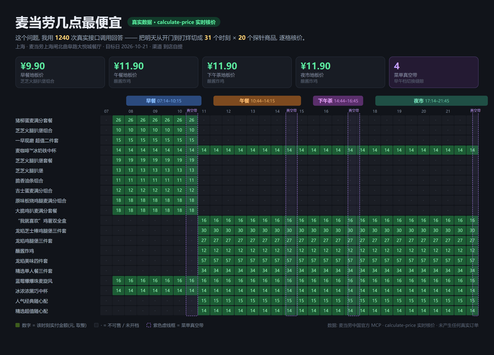
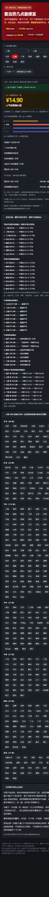
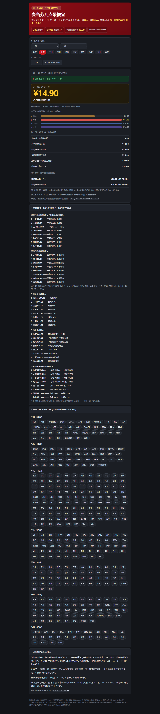

# 麦当劳几点最便宜 (mcd-when)


> **同一家麦当劳，早晚最贵能差 ¥35。**
> 拉萨早餐最便宜一餐 ¥14.00，到了午餐档就是 ¥49.00。
>   
> 我们把**全国 31 个省级行政区、388 座城市**的麦当劳都问了一遍——
>   
> **21038 次逐笔问价**，几点能点什么、多少钱，摊开给你看。



**📖 直接查你自己的城市（不用装任何东西，手机也能开）：<https://mcd-when.app.workbuddy.host/>**

<details>

<summary><b>页面长什么样</b>（点击展开实拍）</summary>

手机端实际效果（深色模式同理，会随系统自动切换）：



桌面端：



</details>

---

<details>

<summary><b>给普通顾客的三句话</b>（不想看技术的话，看到这里就够了）</summary>

1. **绝大多数城市（344/364）早餐档最便宜**：全国早餐地板价中位数 ¥9.90，午餐起就要 ¥11.90。
     
   但也有例外——重庆、郑州、西安等城市反而午餐更便宜，查你自己的城市最靠谱。
2. **别卡点**：一天里有几段「空档」（比如 10:15–10:44），上一档收了、下一档没开，两种都点不到。
3. **开门 ≠ 开吃**：店 7:00 开门，早餐 7:14 才能点；而且不是全国一个时间，
     
   东北 05:14 就能买，重庆要等到 08:14，乌鲁木齐干脆没有早餐档。

</details>

## 先说结论(全国 388 城真机实测, 非推测)

**麦当劳自己把一天切成了四段**, 门店接口直接返回:

> 早餐 → 午餐 → 下午茶 → 夜市, 档与档之间还有「真空带」(两边都点不到)

第一阶段先对 5 座城市地毯式扫完全天(31–48 个时刻 × 20 商品 × 2 渠道, 7000 次核价),
  
得到一条关键规律: **同一商品的价格在一天内恒定, 变的只是「这个时段卖不卖」**。
  
于是第二阶段改用「按档核价」, 单城调用量从 ~1200 次降到 ~70 次 ——
  
全国 388 座城市这才跑得动。

跑到全国之后, 拍到了这些官方不会告诉你的事:

1. **开门 ≠ 开吃**: 门店 07:00 开始营业, 早餐档却要 07:14 才开 ——
     
   开门那一刻, 你什么都点不了。
2. **早餐不是全国同时开档**: 东北和西北的 24 小时店 **05:14** 就能买早餐,
     
   华北多数城市 07:14, 重庆要等到 **08:14**, 福州一家 24 小时店居然是 **09:14**。
     
   早餐开档时间在全国差了整整 4 个小时。
3. **有 24 座城市干脆没有早餐档** —— 乌鲁木齐、宜宾、广安、沧州等地的门店开得太晚,
     
   你起再早也买不到早餐。
4. **早餐便宜不是铁律**: 364 座有早餐档的城市里, 344 座早餐最便宜(地板价中位 ¥9.90);
     
   但重庆、郑州、西安等 **20 座城市反着来** —— 早餐档反而比午餐贵。
     
   所以"几点最便宜"真的是一城一策。
5. **菜单真空带全国都存在**: 两档之间约 29 分钟, 上一档已收、下一档没开,
     
   谁都买不到东西。
6. **得来速不是"同价复刻"**: 142 座城市有得来速, 同一时刻同一件商品,
     
   车道取餐对部分商品反而更便宜(价差是分商品双向的)。

| 城市   | 门店营业        | 早餐开档               | 早餐最便宜一餐 | 午餐最便宜一餐          |
| ---- | ----------- | ------------------ | ------- | ---------------- |
| 北京   | 07:00–22:00 | 07:14              | ¥9.90   | ¥11.90           |
| 上海   | 07:00–23:00 | 07:14              | ¥9.90   | ¥14.90           |
| 广州   | 07:00–22:00 | 07:14              | ¥9.90   | ¥15.90           |
| 兰州   | 00:00–23:59 | **05:14**          | ¥9.90   | ¥14.90           |
| 哈尔滨  | 06:00–02:00 | 06:14              | ¥9.90   | ¥11.90           |
| 重庆   | 08:00–23:00 | 08:14              | ¥14.90  | **¥13.90**(反而便宜) |
| 福州   | 00:00–23:59 | **09:14**(24h 店也晚) | ¥9.90   | ¥11.90           |
| 拉萨   | 00:00–23:59 | 05:14              | ¥14.00  | **¥49.00**(全国最贵) |
| 乌鲁木齐 | 09:00–02:00 | **无早餐档**           | —       | ¥11.90           |

**所有价格均来自 `calculate-price` 实时核价, 未经任何模型估算, 未产生任何真实订单。**

- 在线查你自己的城市(无需 Token): **<https://mcd-when.app.workbuddy.host/>**
- 离线版: [dist/report.html](dist/report.html)(双击即开, 完全自包含)

## 它在回答什么问题

别的项目回答「**买什么**最便宜」。这个项目回答「**什么时候**」:

- 几点之前, 早餐还买得到?
- 我下午 3 点到店, 能点的最便宜一套是什么?
- 得来速和到店自提, 同一时刻同一商品价差多少?
- 麦当劳官方的时段划分, 和真实菜单边界对得上吗?

## 它不做什么

- **不估算价格** —— 所有数字只信 `calculate-price` 的实时返回
- **不替你下单** —— 全链路只读, `create-order` / `auto-bind-coupons` 等写操作一概不碰
- **不做外送** —— 外送价依赖个人收货地址, 属于用户私有配置, 本项目不采集
- **不锁定你的位置** —— 城市 + 关键词任选门店, 谁都能对自己所在的城市跑一遍

## 部署到你自己的 GitHub（GitHub Pages）

报告是**单一静态 HTML**，这也是 GitHub Pages 最省事的一类项目：

```bash
git clone <你的仓库地址> mcd-when && cd mcd-when
python src/render_report.py        # 可选: 重新渲染 dist/report.html
cp dist/report.html index.html     # 根目录的 index.html 就是 Pages 入口
git add index.html && git commit -m "docs: deploy report to Pages" && git push
```

然后在仓库 **Settings → Pages** 里 Source 选 `main` / 根目录，保存后约一 minute 生效，
  
地址形如：`https://<你的用户名>.github.io/mcd-when/`。

> 单文件自包含，没有构建步骤、没有依赖、不需要 CI。

## 用起来（按门槛从低到高）

| 方式        | 适合谁         | 要做什么                                                                    |
| --------- | ----------- | ----------------------------------------------------------------------- |
| **打开网页**  | 所有人（推荐）     | 打开 <https://mcd-when.app.workbuddy.host/> → 选城市 → 选几点去 → 看答案。不用注册、不用装东西 |
| **离线版**   | 没网也想查       | 下载 [dist/report.html](dist/report.html) 双击即开，功能完全一样                     |
| **问 AI**  | 装了 Skill 的人 | 把 `skill/SKILL.md` 加进 AI 客户端，直接问「现在还买得到早餐吗」                             |
| **自己跑数据** | 想跑自己城市的人    | 需要 MCP Token，见下方四步                                                      |

### 自己跑数据（跑你自己城市的门店）

#### 1. 申请 MCP Token

到 [open.mcd.cn/mcp](https://open.mcd.cn/mcp) 手机号登录 → 控制台 → 激活, 复制 Token。

#### 2. 配置环境变量

```bash
# Windows (cmd)
set MCD_MCP_TOKEN=你的token

# Windows (PowerShell)
$env:MCD_MCP_TOKEN="你的token"

# macOS / Linux
export MCD_MCP_TOKEN=你的token
```

(也可以放进 `.env` 文件, 已被 `.gitignore` 排除, 不会入库。)

#### 3. 勘探工具参数(官方没有参数文档, 这一步生成地图)

```bash
python src/discover.py
```

#### 4. 普查(今天跑明天, 不用等真实时间)

```bash
python src/probe_cities.py                          # 探测全国哪些城市有门店(每城 1 次调用)
python src/survey_national.py --city 苏州           # 采集某一座城市
python src/survey_national.py                       # 全国(断点续跑, 崩了 --resume 接着来)
python src/survey.py --city 上海                    # 老脚本: 全时刻地毯式(用于交叉验证)
```

官方接口的 `reservationDate` 允许指定未来任意时刻, 所以 **一次运行就能把明天
  
从开门到打烊全部核价**, 不需要挂定时任务。

成本模型: 实测「同一商品全天一个价」之后, 单城只需 ~70 次调用 ——
  
否则 388 城按旧方案要 47 万次, 根本跑不完。

#### 5. 渲染报告

```bash
python src/render_report.py    # -> dist/report.html (问答式, 双击即开)
python src/render_card.py      # -> dist/card.html   (README 首图源)
```

没有 Token 想先看看长什么样? `python src/make_demo.py` 生成演示数据
  
(页面会带「示例价格」徽标, 拿到真实数据后自动摘掉)。

#### 6. 此刻决策(打开就能用的那一句)

```bash
python src/now.py --city 上海
```

真实输出(2026-10-20 10:58 实测):

```text
门店: 麦当劳上海闸北曲阜路大悦城餐厅(上海) · 服务端时间 10:58
现在是午餐档(10:44–14:15)。
此刻最便宜能吃到的: 蘸酱炸鸡 ¥11.90
216 分钟后进入下午茶档(14:44起), 届时最便宜: 蘸酱炸鸡 ¥11.90
👉 现在下单更划算, 下一档没有更便宜的选择。
```

矩阵回答「全天规律」, `now.py` 回答「我现在该怎么办」——
  
当前档最便宜的一口、下一档还有几分钟开、等不等。全程只读, 不落单。

## 目标用户

- **每一位麦当劳顾客** —— 打开在线报告就能查「几点能点什么、哪个时段最划算」，
    
  不用注册、不用装任何东西，手机上也能看
- 对「连锁餐饮的时段定价」好奇的数据爱好者
- 想看看 MCP 能做什么的开发者 —— `data/tool-schemas.json` 里有一份官方没给的
    
  完整工具参数文档(35 个工具的 inputSchema 全量落盘)

## Skill 化(可被 AI 客户端直接装载)

`skill/SKILL.md` 是本项目的 Skill 封装，AI 客户端加载后可直接用自然语言问
  
「现在还买得到早餐吗 / 此刻最便宜吃什么」并触发 `src/now.py`。
  
它同时把真机验证过的接口事实（渠道枚举、单位、时段表解析陷阱、只读白名单）
  
写进了上下文，避免重复探错。

## 技术说明

- 零第三方依赖, 纯 Python 标准库, Python 3.10+ 直接跑
- MCP 接入细节、工具调用链与业务价值: [docs/MCP\_INTEGRATION.md](docs/MCP_INTEGRATION.md)
- 限流安全: 内置 600 次/分钟节流与 429 退避
- 合规: 本项目为 2026 麦当劳程序员创意开发大赛参赛作品, 非麦当劳官方产品;
    
  遵守《麦当劳 MCP 服务规则》, 不商用、不导流、不含任何凭证(Token 只走环境变量)

## 自检

```bash
python -m unittest discover tests          # 9 项冒烟测试(数据/分类/产物, 零依赖)
python src/check_layout.py dist/report.html # 四视口零溢出体检
```

## 参与方式

见 [CONTRIBUTING.md](CONTRIBUTING.md)。觉得某个价格和 App 对不上？直接开 issue，
  
每座城市都留了门店编号和核价日期，可复核。

## 许可证

[MIT](LICENSE)。注意: 「麦当劳 / McDonald's」是各自持有人的商标,
  
本项目与麦当劳官方无隶属、背书或赞助关系, 不含也不再分发任何麦当劳的
  
Logo、图片或商业素材; 页面展示的价格是运行时从官方订餐接口实时读取的,
  
随时可能变动, 下单前请以麦当劳 App 实际显示为准。

## 仓库结构

```
mcd-when/
├── README.md                  你在这里
├── CHANGELOG.md               版本演进
├── CONTRIBUTING.md            参与方式 / 代码约定
├── LICENSE                    MIT(含商标声明)
├── docs/
│   ├── MCP_INTEGRATION.md     MCP 调用链说明
│   ├── PROMO.md               四平台宣发文案
│   ├── CONTEST_DECLARATION.md 参赛声明(官方原文, 未改动)
│   └── ADVANCED.md            进阶: 批量核价与按需单城查询
├── tests/test_smoke.py        零依赖冒烟测试(9 项)
├── mcp-config.example.json    MCP 配置示例(环境变量占位符)
├── config.example.json        普查配置示例(城市/渠道)
├── skill/SKILL.md             Skill 封装(AI 客户端可装载)
├── workbuddy.md               WorkBuddy 专项奖励说明
├── src/
│   ├── mcd_client.py          Streamable HTTP MCP 客户端(零依赖, 内置限流)
│   ├── discover.py            工具参数 schema 勘探
│   ├── cities_cn.py           全国城市清单(31 省, 含百强县)
│   ├── probe_cities.py        全国门店探测(每城 1 次调用)
│   ├── survey_national.py     全国普查(按档核价, 断点续跑)
│   ├── survey_batch.py        批量核价(一次拿全菜单, 按需单城查询)
│   ├── survey.py              全天地毯式普查(老脚本, 交叉验证基准)
│   ├── analyze_surface.py     验证「价格全天恒定」等关键假设
│   ├── analyze_national.py    全国结论汇总(开档时间/价差/异常值)
│   ├── now.py                 此刻决策(当前最便宜/下一档倒计时)
│   ├── render_report.py       渲染问答式报告 HTML(全国版)
│   ├── render_card.py         渲染 README 首图(dist/card.html)
│   ├── check_layout.py        排版零溢出体检(四视口自动检测)
│   └── make_demo.py           演示数据生成(仅预览 UI)
├── data/                      工具 schema / 城市探测 / 全国价格表
├── images/                    README 首图 + 实拍截图
└── dist/                      report.html(交互报告) / card.html(首图源)
```
