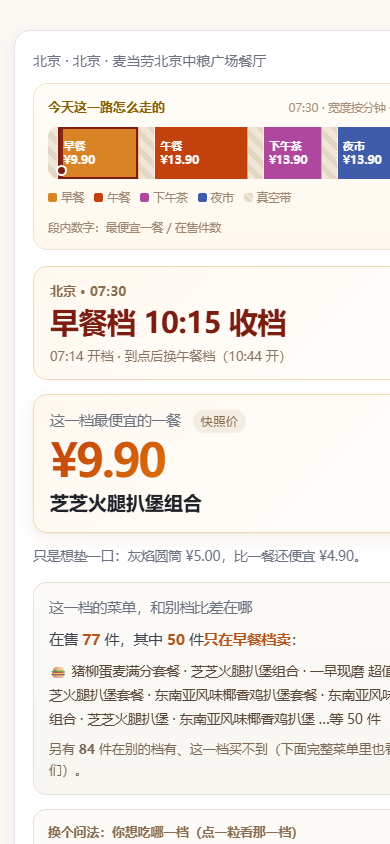
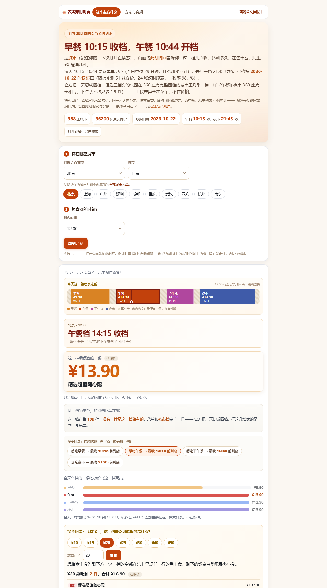
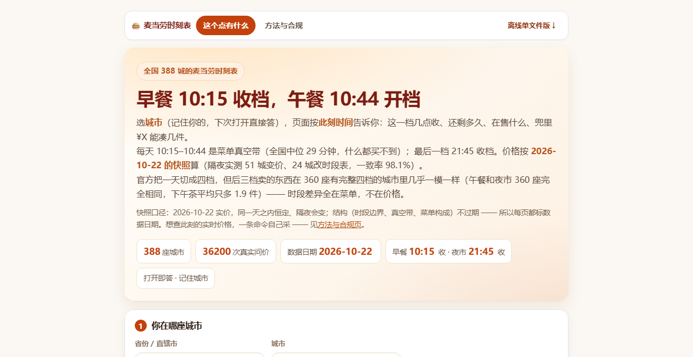
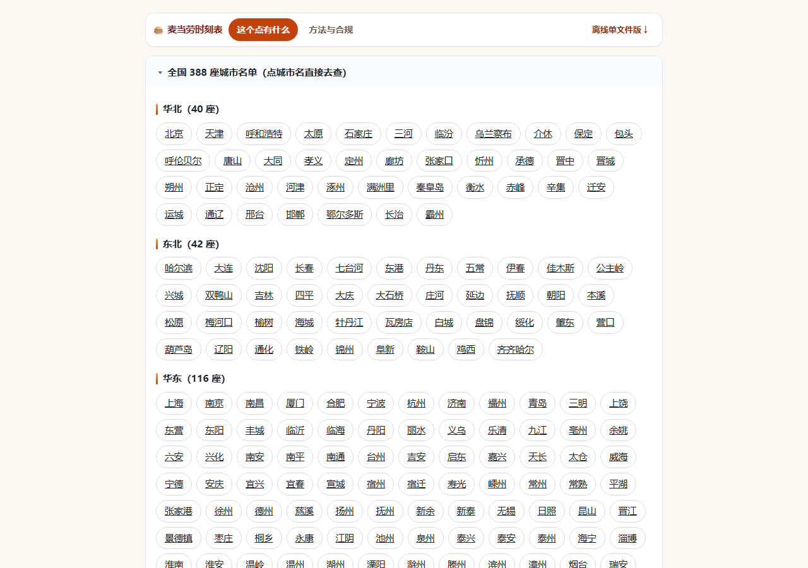
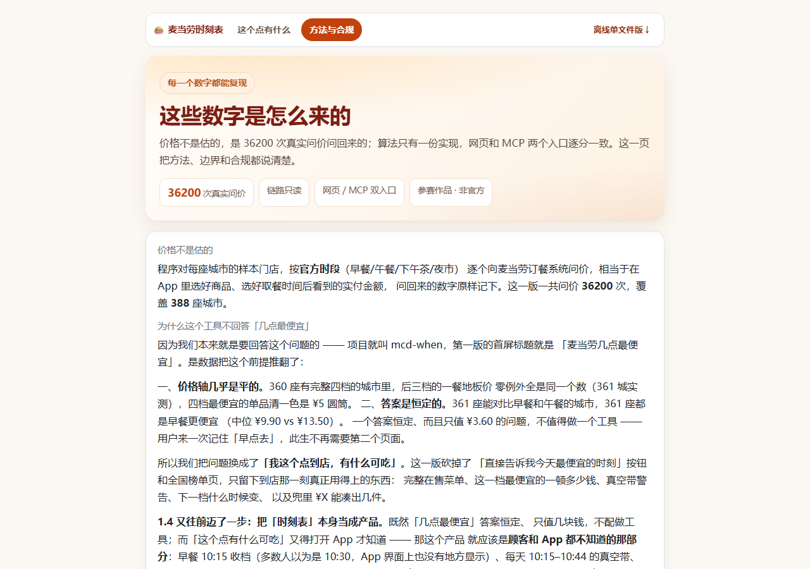

# 麦当劳时刻表 (mcd-when)


> **官方把一天切成四档，但后三档卖的东西一模一样。**

> 全国 360 座有完整四档的城市里，午餐和夜市的菜单 100% 相同，下午茶平均只多 1.9 件学生专享；
> 只有早餐是另一套菜单 —— 便宜 ¥3.60，但少 80 件，换来 50 件只属于早晨的麦满分。

> 所以「几点最便宜」的答案永远是早上 —— 那句话没有信息量。这个项目因此不回答「几点最便宜」，
> 把 **when（时刻表）当成主产品，what（菜单）当成跟着 when 走的载荷**：打开页面先记住你的城市，
> 然后按**此刻时间**直接告诉你这一档几点收、还剩多久、在售什么、兜里 ¥X 能凑几件。
> 我们把**全国 31 个省级行政区、388 座城市**的麦当劳都问了一遍 —— **36200 次逐笔问价**
> （其中 387 城是完整菜单逐商品核价）：早餐 10:15 收档、午餐 10:44 开档（全国中位），
> 每天 10:15–10:44 是菜单真空带，什么都买不到；最后一档 21:45 收档。
> 价格按 2026-10-22 的快照算（日内恒定、隔夜会变），这一档最便宜的一顿、兜里 ¥X 能凑几件，摊开给你看。


**📖 直接查你自己的城市（不用装任何东西，手机也能开）：<https://crimsonkernel.github.io/mcd-when/>**

<details>

<summary><b>页面长什么样</b>（点击展开实拍）</summary>

手机端实际效果（深色模式同理，会随系统自动切换）：



桌面端（答案卡：截止时间主数字 + 全天时段带和「此刻」指针 + 这一档的菜单和别档差在哪 + 完整在售菜单）：



两页站点 —— 问答页 / 方法与合规，完整城市名单在问答页底部：






</details>

---

<details>

<summary><b>给普通顾客的三句话</b>（不想看技术的话，看到这里就够了）</summary>

1. **能早餐午餐都吃到正餐的 361 座城市，361 座都是早餐更便宜——没有例外**：
   
   全国早餐地板价中位数 ¥9.90，午餐中位 ¥13.50。所以「几点最便宜」的答案永远是早上 ——
   但也因为**永远是早上**，这个问题没有信息量。真正的差别在菜单：午餐和夜市卖的
   是同一套东西（360 座城市 100% 相同），只有早餐是另一套，便宜 ¥3.60 但少 80 件。
2. **别卡点**：一天里有几段「空档」（比如 10:15–10:44），上一档收了、下一档没开，两种都点不到。
3. **开门 ≠ 开吃**：店 7:00 开门，早餐 7:14 才能点；而且不是全国一个时间，
     
   143 座城市 05:14 就能买，重庆要等到 08:14，乌鲁木齐干脆没有早餐档。
4. **兜里多少钱，就给你凑多少东西**：选好城市和时段，页面上直接问「我有 ¥20 能吃到什么」——
   
   0/1 背包在**这一档的完整在售菜单上现算**（有主食是硬门槛，不是优先级），
   打开就有答案，零 Token、不用装任何东西。网页端算的这套背包和 MCP 端逐分对拍过，
   同一个问题两个入口同一个答案（`src/parity_combo.py`，207 个用例零不一致）。

</details>

## 先说结论(全国 388 城真机实测, 非推测)

**麦当劳自己把一天切成了四段**, 门店接口直接返回:

> 早餐 → 午餐 → 下午茶 → 夜市, 档与档之间还有「真空带」(两边都点不到)

第一阶段先对 5 座城市地毯式扫完全天(31–48 个时刻 × 20 商品 × 2 渠道, 7000 次核价),
  
得到一条关键规律: **同一商品的价格在一天内恒定, 变的只是「这个时段卖不卖」**
—— 而且后来全国普查发现, 变的往往只是早餐: 后三档在 360 座城市里菜单完全相同。
  
于是第二阶段改用「按档核价」, 单城调用量从 ~1200 次降到 ~70 次 ——
  
全国 388 座城市这才跑得动。

跑到全国之后, 拍到了这些官方不会告诉你的事:

1. **开门 ≠ 开吃**: 门店 07:00 开始营业, 早餐档却要 07:14 才开 ——
     
   开门那一刻, 你什么都点不了。
2. **早餐不是全国同时开档**: **143 座城市 05:14** 就能买早餐(其中不少是
   00:00–23:59 的 24 小时店), 但同样有 141 座城市要等到 **07:14**,
   重庆 **08:14**, 最晚的福州 **09:14** —— 早餐开档时间在全国差了整整 4 个小时。
3. **有 24 座城市干脆没有早餐档** —— 乌鲁木齐、宜宾、广安、沧州等地的门店开得太晚,
     
   你起再早也买不到早餐。
4. **「几点最便宜」的答案是早上, 但这个问题问错了**: 361 座能对比早餐和午餐的城市,
   **361 座全部早餐更便宜**(中位 ¥9.90 vs ¥13.50), 最便宜的单品四档全是 ¥5 圆筒 ——
   价格轴几乎是平的, 所以「几点最便宜」的默认答案永远是赶早, 这句话没有信息量。
   真正的断层在**菜单轴**: 360 座有完整四档的城市里, **午餐和夜市的菜单 100% 相同**,
   下午茶平均只多 1.9 件学生专享; 只有早餐是另一套菜单 —— 便宜 ¥3.60, 但少 80 件,
   换来 50 件只属于早晨的麦满分。所以该问的是「我这个点到店, 赶得上哪一档、
   这一档有什么可吃」——**时刻表是产品, 菜单是载荷**。
5. **菜单真空带全国都存在**: 两档之间约 29 分钟, 上一档已收、下一档没开,
     
   谁都买不到东西。
6. **得来速不是"同价复刻"**: 142 座城市有得来速, 同一时刻同一件商品,
     
   车道取餐对部分商品反而更便宜(价差是分商品双向的)。

| 城市   | 门店营业 | 早餐开档 | 早餐最便宜一餐 | 午餐最便宜一餐 |
| ---- | ---- | ---- | ---- | ---- |
| 北京   | 07:00–22:00 | 07:14 | ¥9.90（芝芝火腿扒堡组合） | ¥13.90（精选超值随心配） |
| 上海   | 07:00–23:00 | 07:14 | ¥9.90（芝芝火腿扒堡组合） | ¥13.90（精选超值随心配） |
| 广州   | 07:00–22:00 | 07:14 | ¥9.90（芝芝火腿扒堡组合） | ¥13.90（精选超值随心配） |

**所有价格均来自 `calculate-price` 实时核价, 未经任何模型估算, 未产生任何真实订单。**

- 在线查你自己的城市(无需 Token): **<https://crimsonkernel.github.io/mcd-when/>**（问答 / 方法与合规 两页，底部附完整城市名单）
- 离线版: [dist/report.html](dist/report.html)(双击即开, 完全自包含, 断网也能用)

## 它在回答什么问题

别的项目回答「**买什么**最便宜」。这个项目原本回答「**什么时候**最便宜」——
是数据把这个问题本身否掉了：四档最便宜的单品全是 ¥5 圆筒、后三档一餐地板价
361 城零例外同价、361 座能对比的城市全是早餐更便宜。答案恒定还只值 ¥3.60 的问题，
不值得做一个工具。1.2 起它改问「这个点有什么可吃」，1.4 再往前推一步 ——
**把时刻表本身当成产品：先答「赶不赶得上」，再答「这一档吃什么」**。
页面打开即答（记住城市、按此刻时间渲染、每 30 秒心跳，跨档才整卡重渲）：

- **我这个点出发/到店，还赶得上这一档吗？** ← 答案卡第一眼是「X 档 HH:MM 收档，还剩 N 分钟」
- **想吃早餐，最晚几点到店？** ← 反向问法：10:15 收档是知识，不是数据——顾客多以为是 10:30，App 也不显示截止时间
- 我下午 3 点到店, 这一刻的完整在售菜单是什么?
- 这一档最便宜的一顿多少钱(快照价), 是谁?
- **我有 ¥20，这一档能吃到最饱的是什么？** ← 页面上直接算，不用问 AI
- 真空带里站在门口, 上一档几点收的、下一档几点开?（真空期答案卡直接说「什么都买不到」，不列空菜单）
- 得来速和到店自提, 同一时刻同一商品价差多少?
- 异地旅行: 重庆的早餐几点开?（App 的答案跟着当前定位城市走，换城市要手动切）

「¥20 能吃到什么」这类问题，答案是 0/1 背包在本地菜单数据上跑出来的：
先保证有一口能当饭的（有主食是硬门槛，不是优先级），再尽量多件。
所以 ¥10 的午餐档会告诉你「吃不到一顿正经饭，最便宜的一餐 ¥13.90，还差 ¥3.90」，
而不是扔给你两个冰淇淋凑数。

页面上还嵌了这一档的**完整在售菜单**（全国 269 个唯一商品名，按下标编码只要 1.8 MB）：
可以按价格/名称排序、只要主食或只要小食，也可以点任一行的「当主食」——
你选的那件是**必选**的，剩下的钱自动配最多小食。网页端算的这套背包和 MCP 端
逐分对拍过（`src/parity_combo.py`，207 个用例零不一致），同一个问题两个入口同一个答案。

答案上方还有一条**全天时段带**：早餐/午餐/下午茶/夜市各占多宽，是按真实起止分钟数
等比例画的，不是四等分——所以「10:15–10:44 那段真空带窄得可怜」这件事一眼就能看出来。
点任意一段，答案直接跳到那一档。

## 它不做什么

- **不估算价格** —— 所有数字只信 `calculate-price` 的实时返回
- **不替你下单** —— 全链路只读, `create-order` / `auto-bind-coupons` 等写操作一概不碰
- **不做外送** —— 外送价依赖个人收货地址, 属于用户私有配置, 本项目不采集
- **不锁定你的位置** —— 城市 + 关键词任选门店, 谁都能对自己所在的城市跑一遍

## 部署到你自己的 GitHub（GitHub Pages）

站点是**两页静态 HTML**（问答 / 方法与合规，共享一份 `mcd-data.js`；
全国榜单页在 1.2 被砍掉——「哪座城最便宜」正是被我们自己的数据否掉的问题，
完整城市名单改放在问答页底部，点城市名直接去查），
仓库里已经带好了 Pages 工作流（`.github/workflows/pages.yml`），
推送即上线，不用手工传文件：

```bash
git clone <你的仓库地址> mcd-when && cd mcd-when
# 仓库 Settings → Pages → Source 选「GitHub Actions」，保存一次即可
# 之后每次 push 到 main 都会自动重新部署
```

地址形如：`https://<你的用户名>.github.io/mcd-when/`，根路径就是问答页。
本项目的线上版：**<https://crimsonkernel.github.io/mcd-when/>**。

> 没有构建步骤、没有依赖、不需要装东西。
> 想完全手动也行：`python src/render_report.py` 重新渲染后，
> `cp dist/index.html dist/how.html dist/mcd-data.js <你的站点目录>/`。
>
> 另有一份**单文件离线版** `dist/report.html`：数据全部内联，双击即开、
> 断网也能用，导航里也能下载到（「离线单文件版 ↓」）。

## 用起来（按门槛从低到高）

| 方式        | 适合谁         | 要做什么                                                                    |
| --------- | ----------- | ----------------------------------------------------------------------- |
| **打开网页**  | 所有人（推荐）     | 打开 <https://crimsonkernel.github.io/mcd-when/> → 选城市 → 选几点去 → 看答案，还能直接问「¥20 能吃到什么」。不用注册、不用装东西 |
| **离线版**   | 没网也想查       | 下载 [dist/report.html](dist/report.html) 双击即开，功能完全一样                     |
| **问 AI**  | 装了 Skill 的人 | 把 `skill/SKILL.md` 加进 AI 客户端，直接问「现在还买得到早餐吗」                             |
| **自己跑数据** | 想跑自己城市的人    | 需要 MCP Token，见下方六步                                                      |

### 自己跑数据（跑你自己城市的门店）

只想查「我现在这座店买得到什么、几块钱、下一档什么时候变」？一条命令，
十几秒出结果，全程只读：

```bash
export MCD_MCP_TOKEN=你的token
python src/now.py --city 上海
```

（网页上是 **2026-10-22 的实价快照**：日内实测价格恒定，但**隔一天就会变**——
拿仓库里 10-21 探针和 10-22 全菜单两个快照互验，387 座共同城市 12552 个
「渠道→商品→时段」可比值里 98.1% 一致，51 城 234 个单元格变价（涨 156/降 78，
其中 114 条是 ¥13.90 促销价回到常规价）、24 城时段表变了；而真空带缺口
（10:15 收、10:44 开）387 城纹丝不动。**结构不过期，价格会过期**，所以每页都标
数据日期。实时查询交给用户本机，原因见[方法与合规页](dist/how.html)：官方限流
600 次/分钟/Token，而全国普查一共问价 36200 次，满速也要连续跑 60 分钟以上；
且订餐接口对浏览器跨域访问返回 403、Token 进前端既不安全也不合规。）

#### 1. 申请 MCP Token

到 [open.mcd.cn/mcp](https://open.mcd.cn/mcp) 手机号登录 → 控制台 → 激活, 复制 Token。

#### 2. 配置环境变量

```bash
# Windows (cmd)
set MCD_MCP_TOKEN=你的token

# Windows (PowerShell)
$env:MCD_MCP_TOKEN="你的token"

# macOS / Linux
export MCD_MCP_TOKEN=你的token
```

(也可以放进 `.env` 文件, 已被 `.gitignore` 排除, 不会入库。)

#### 3. 勘探工具参数(官方没有参数文档, 这一步生成地图)

```bash
python src/discover.py
```

#### 4. 普查(今天跑明天, 不用等真实时间)

```bash
python src/probe_cities.py                          # 探测全国哪些城市有门店(每城 1 次调用)
python src/survey_national.py --city 苏州           # 采集某一座城市
python src/survey_national.py                       # 全国(断点续跑, 崩了 --resume 接着来)
python src/survey.py --city 上海                    # 老脚本: 全时刻地毯式(用于交叉验证)
```

官方接口的 `reservationDate` 允许指定未来任意时刻, 所以 **一次运行就能把明天
  
从开门到打烊全部核价**, 不需要挂定时任务。

成本模型: 实测「同一商品全天一个价」之后, 单城只需 ~70 次调用 ——
  
否则 388 城按旧方案要 47 万次, 根本跑不完。

#### 5. 渲染报告

```bash
python src/render_report.py    # -> dist/{index,how}.html + mcd-data.js
                              #    + dist/report.html (单文件离线版)
python src/render_card.py      # -> dist/card.html   (README 首图源)
```

没有 Token 想先看看长什么样? `python src/make_demo.py` 生成演示数据
  
(页面会带「示例价格」徽标, 拿到真实数据后自动摘掉)。

#### 6. 此刻决策的输出长什么样

（命令就是上面那一句，加 `--json` 可以拿去接别的程序。）真实输出
(2026-10-20 10:58 实测):

```text
门店: 麦当劳上海闸北曲阜路大悦城餐厅(上海) · 服务端时间 10:58
现在是午餐档(10:44–14:15)。
此刻最便宜能吃到的: 蘸酱炸鸡 ¥11.90
216 分钟后进入下午茶档(14:44起), 届时最便宜: 蘸酱炸鸡 ¥11.90
👉 现在下单更划算, 下一档没有更便宜的选择。
```

矩阵回答「全天规律」, `now.py` 回答「我现在该怎么办」——
  
当前档最便宜的一口、下一档还有几分钟开、等不等。全程只读, 不落单。

## 目标用户

- **每一位麦当劳顾客** —— 打开在线报告就能查「几点能点什么、哪个时段最划算」，
    
  不用注册、不用装任何东西，手机上也能看
- 对「连锁餐饮的时段定价」好奇的数据爱好者
- 想看看 MCP 能做什么的开发者 —— `data/tool-schemas.json` 里有一份官方没给的
    
  完整工具参数文档(35 个工具的 inputSchema 全量落盘)

## Skill 化(可被 AI 客户端直接装载)

`skill/SKILL.md` 是本项目的 Skill 封装，AI 客户端加载后可直接用自然语言问
  
「现在还买得到早餐吗 / 此刻最便宜吃什么」并触发 `src/now.py`。
  
它同时把真机验证过的接口事实（渠道枚举、单位、时段表解析陷阱、只读白名单）
  
写进了上下文，避免重复探错。

## 技术说明

- 零第三方依赖, 纯 Python 标准库, Python 3.10+ 直接跑
- MCP 接入细节、工具调用链与业务价值: [MCP_INTEGRATION.md](MCP_INTEGRATION.md)
- 限流安全: 内置 600 次/分钟节流与 429 退避
- 合规: 本项目为 2026 麦当劳程序员创意开发大赛参赛作品, 非麦当劳官方产品;
    
  遵守《麦当劳 MCP 服务规则》, 不商用、不导流、不含任何凭证(Token 只走环境变量)

## 自检

```bash
python -m unittest discover tests           # 42 项冒烟测试(数据/分类/算法/产物, 零依赖)
python src/render_report.py                 # 渲染三产物(含 5 个文件的脚本语法自检, 挂了构建失败)
python src/parity_combo.py                  # 页面 JS 背包 vs Python 背包逐分对拍(207 例)
python src/check_layout.py                  # 三产物 × 四视口零溢出体检
python src/check_combo.py                   # 预算搭配器实测(单文件 + 两页两入口, 各 14 条路径)
```

## 参与方式

见 [CONTRIBUTING.md](CONTRIBUTING.md)。觉得某个价格和 App 对不上？直接开 issue，
  
每座城市都留了门店编号和核价日期，可复核。

## 许可证

[MIT](LICENSE)。注意: 「麦当劳 / McDonald's」是各自持有人的商标,
  
本项目与麦当劳官方无隶属、背书或赞助关系, 不含也不再分发任何麦当劳的
  
Logo、图片或商业素材; 页面展示的价格是运行时从官方订餐接口实时读取的,
  
随时可能变动, 下单前请以麦当劳 App 实际显示为准。

## 仓库结构

```
mcd-when/
├── README.md                  你在这里
├── CHANGELOG.md               版本演进
├── CONTRIBUTING.md            参与方式 / 代码约定
├── LICENSE                    MIT(含商标声明)
├── CONTEST_DECLARATION.md     参赛声明(官方原文, 文件名未改动 —— 赛事硬性要求)
├── MCP_INTEGRATION.md         MCP 调用链说明(赛事硬性要求, 文件名未改动)
├── workbuddy.md               WorkBuddy 专项奖励说明
├── docs/
│   ├── PROMO.md               四平台宣发文案
│   ├── ADVANCED.md            进阶: 批量核价与按需单城查询
│   └── MCP_DEMO.md            MCP 客户端演示脚本
├── tests/test_smoke.py        零依赖冒烟测试(42 项)
├── mcp-config.example.json    MCP 配置示例(环境变量占位符)
├── mcp-when-config.example.json  mcd-when + 官方 MCP 双 Server 配置
├── config.example.json        普查配置示例(城市/渠道)
├── skill/SKILL.md             Skill 封装(AI 客户端可装载)
├── src/
│   ├── mcd_client.py          Streamable HTTP MCP 客户端(零依赖, 内置限流)
│   ├── discover.py            工具参数 schema 勘探
│   ├── cities_cn.py           全国城市清单(31 省, 含百强县)
│   ├── probe_cities.py        全国门店探测(每城 1 次调用)
│   ├── survey_national.py     全国普查(按档核价, 断点续跑)
│   ├── survey_batch.py        批量核价(一次拿全菜单, 按需单城查询)
│   ├── survey.py              全天地毯式普查(老脚本, 交叉验证基准)
│   ├── analyze_surface.py     验证「价格全天恒定」等关键假设
│   ├── analyze_national.py    全国结论汇总(开档时间/价差/异常值)
│   ├── now.py                 此刻决策(当前最便宜/下一档倒计时)
│   ├── render_report.py       渲染两页版站点 + 单文件离线版(含脚本语法自检)
│   ├── render_card.py         渲染 README 首图(dist/card.html)
│   ├── check_layout.py        排版零溢出体检(三产物 × 四视口自动检测)
│   ├── check_combo.py         预算搭配器实测(无头浏览器, 两个入口 × 14 条路径)
│   ├── parity_combo.py        页面 JS 背包 vs Python 背包逐分对拍(207 例)
│   ├── combo.py               「预算内怎么点最饱」核心算法(MCP 与页面共用)
│   ├── mcp_server.py          本地 MCP Server(5 个工具, 零 Token)
│   └── make_demo.py           演示数据生成(仅预览 UI)
├── tools/
│   └── shot_readme.py         重新生成 README 实拍截图(界面改版后跑这个)
├── data/                      价格表 / 城市探测 / 工具 schema
├── images/                    README 首图 + 实拍截图
└── dist/                      index/how.html(两页版) + mcd-data.js(共享数据)
                               + report.html(单文件离线版) + card.html(首图源)
```
